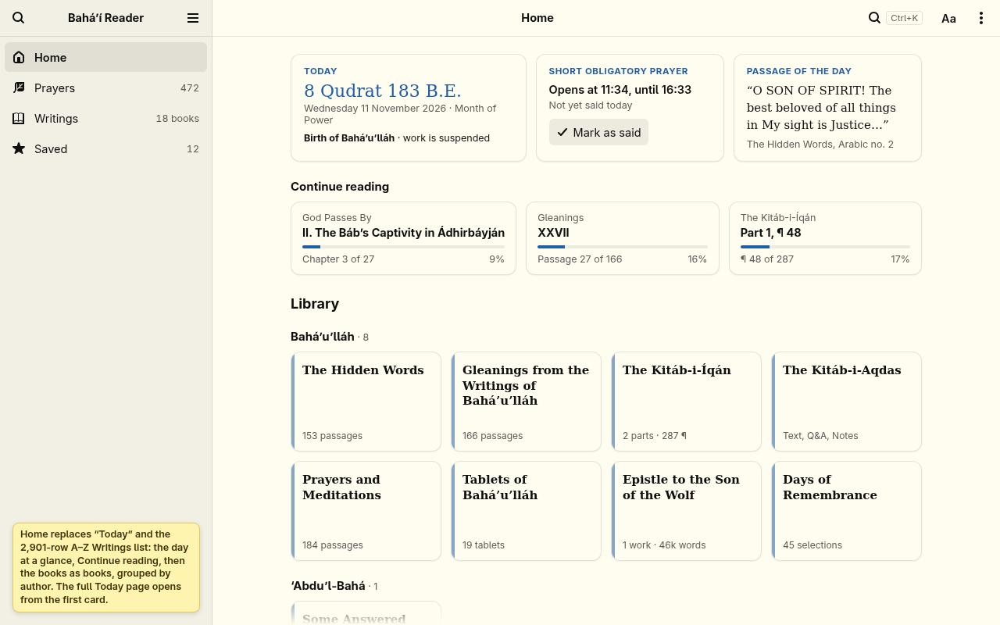
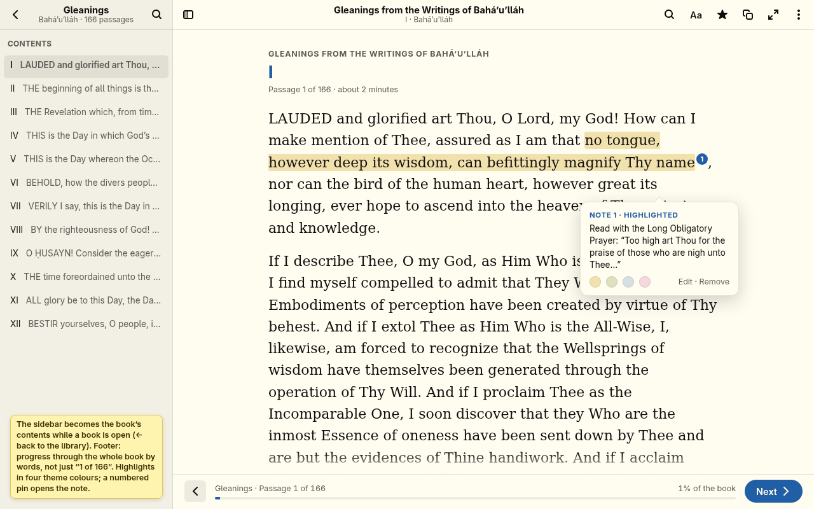
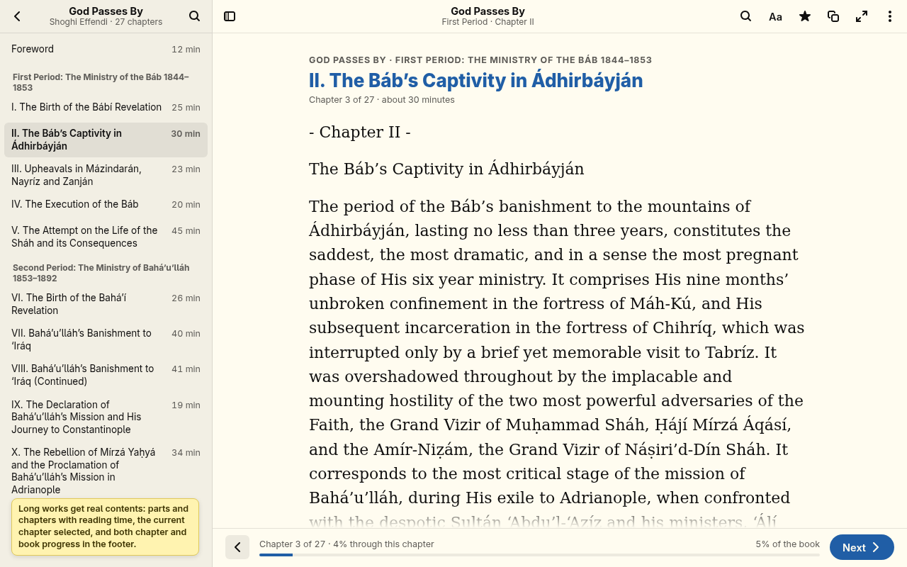
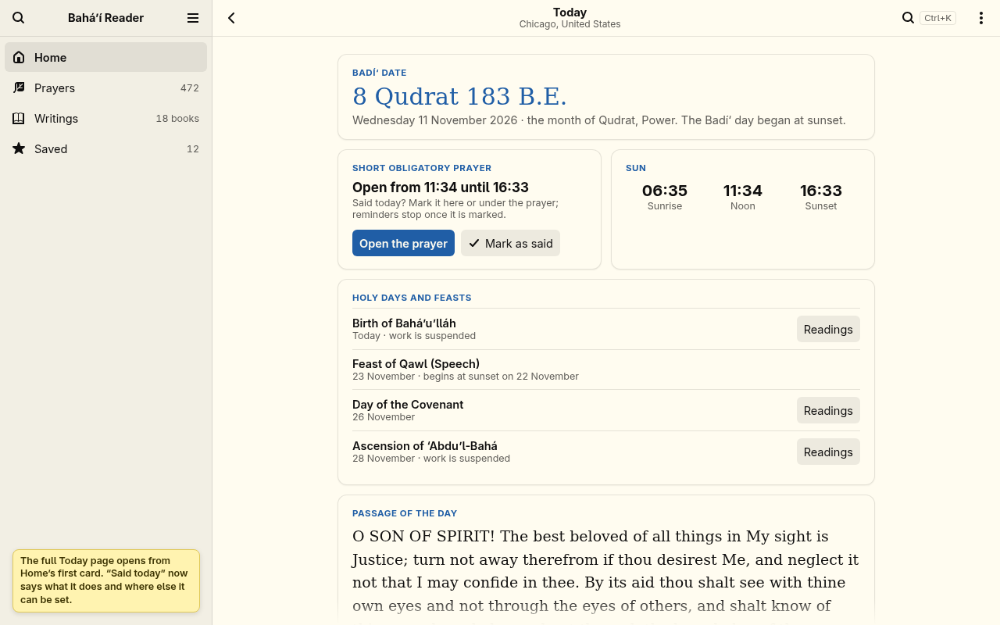
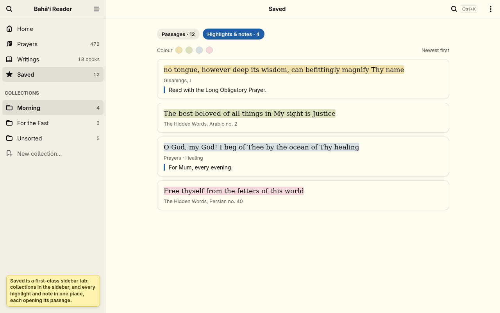
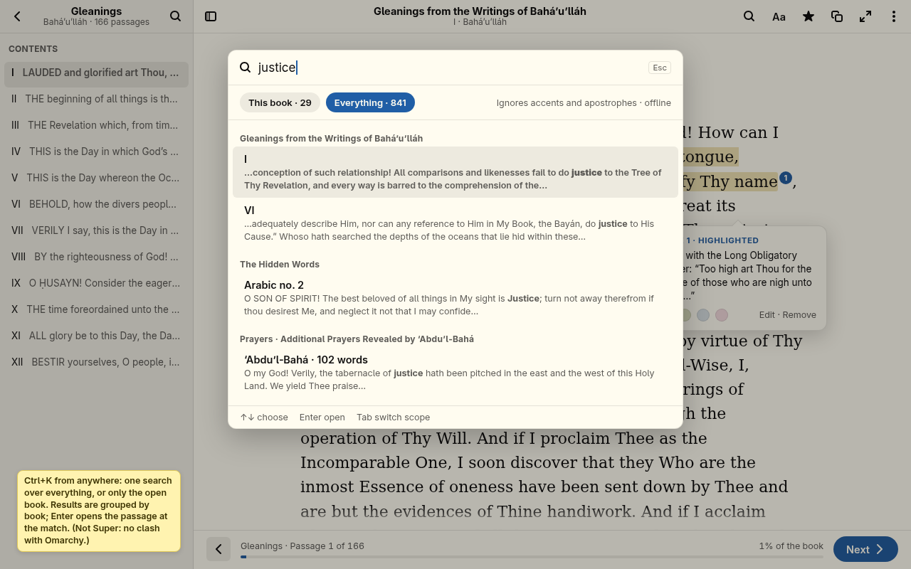
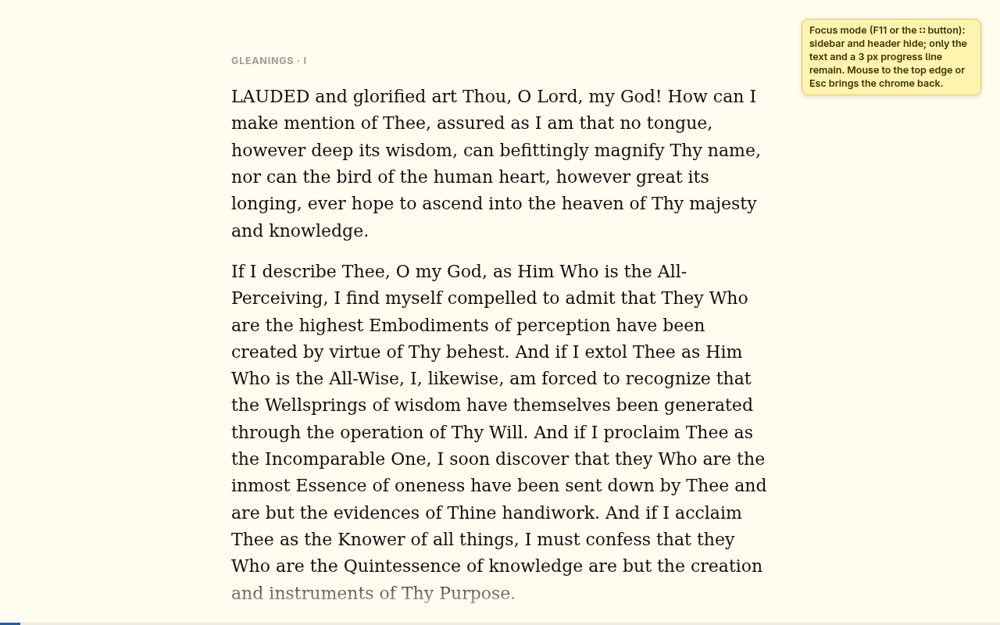
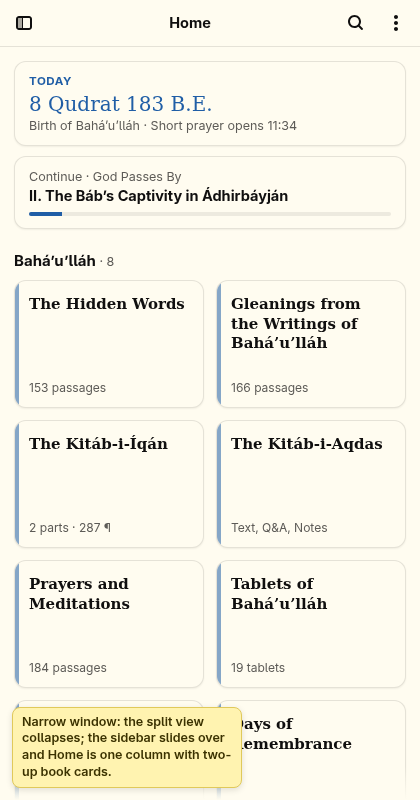
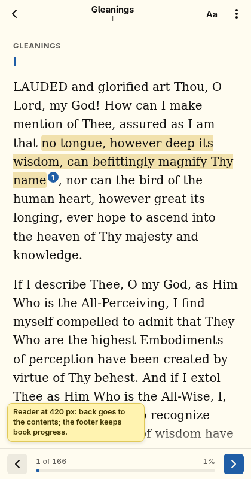
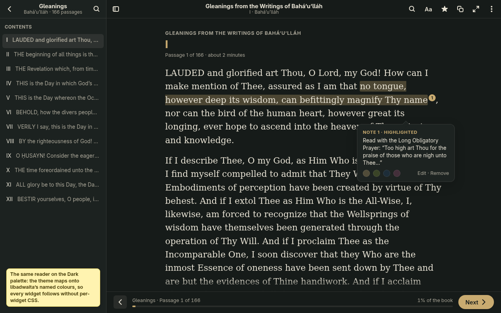

# Phase 2 mockups: libadwaita shell (for Tim’s approval)

**Status: waiting for Tim’s approval. Nothing here is built.** The new shell (Phase 2, step 3 onward) starts only after these are approved or changed.

These are stills, drawn as HTML in libadwaita’s layout and rendered in headless Chrome. They are not screenshots of running code. Every quotation, title and count comes from the app’s bundled library (`extract.py`); nothing is reworded. What changes from day to day or person to person (the passage of the day, Continue reading positions and percentages, saved counts, highlights and notes) is example data. Light screens use Tim’s current Omarchy theme (Flexoki Light, from `colors.toml`); one screen uses the app’s Dark palette. The yellow sticky notes are explanations for review, not part of the design.

| # | Screen | File |
| --- | --- | --- |
| 1 | Home: the day at a glance, Continue reading, the library as books grouped by author |  |
| 2 | Reader: book contents in the sidebar, a sense of place above the text, book progress in the footer, a highlight with a note |  |
| 3 | Reader for a long work (God Passes By): parts and chapters with reading times, chapter and book progress |  |
| 4 | Today, full page |  |
| 5 | Saved: collections in the sidebar, highlights and notes |  |
| 6 | Ctrl+K search with a This book / Everything scope |  |
| 7 | Focus mode |  |
| 8 | Narrow (420 px): Home |  |
| 9 | Narrow (420 px): Reader |  |
| 10 | Reader in the Dark palette |  |

## What the design decides (please confirm or change)

1. **Sidebar: Home, Prayers, Writings, Saved** (as in the review). Today is no longer its own section: its essentials are the first row of Home, and the full Today page (screen 4) opens from there and from Ctrl+T. **Obligatory prayers** become the first group under Prayers, with the counter. **The Hidden Words** is a book in the library under Bahá’u’lláh.
2. **Writings is the library**, not a list: 18 books as cards grouped by author in the review’s author order. This replaces the 2,901-row A–Z tree. Opening a book turns the sidebar into that book’s contents (← goes back to the library).
3. **Continue reading** keeps the last place in up to three books (stored in settings; nothing leaves the computer).
4. **Reader header:** the book as title and the passage as subtitle; search, Aa, save, copy, focus and the ⋮ menu. **Footer:** Previous, a progress bar through the whole book (by words) with “Passage 1 of 166” or “Chapter 3 of 27”, and Next as the one primary button. The text fades out above the footer, as in Phase 1.
5. **Highlights and notes:** select words, choose one of four colours (from the theme: yellow, green, blue, magenta), and add a note if wanted. A numbered pin marks a note and opens it in a popover. They are stored in settings.json beside saved passages, by passage id and character offsets, so they survive app updates. They are never written into the text.
6. **Saved** has two tabs: Passages (the current collections) and Highlights & notes.
7. **Ctrl+K** opens search from anywhere, scoped to the open book or to everything, results grouped by book. Same offline, accent-insensitive matching as today. The per-section contents search (Ctrl+F) stays.
8. **Focus mode:** F11 or the ⛶ button hides the sidebar and header; Esc brings them back. F11 and Ctrl+K are not bound by Omarchy or Hyprland on TUF (checked in `/usr/share/omarchy/default/hypr/bindings`). No Super keys.
9. **Narrow windows:** `AdwNavigationSplitView` collapses below about 700 px; the sidebar becomes the first page and Back returns to it.
10. **Theme mapping:** Omarchy `colors.toml` is mapped onto libadwaita’s named colours instead of styling each widget: `window_bg_color` and `view_bg_color` ← `background`, `window_fg_color` ← `foreground`, `sidebar_bg_color` ← `dark_background` (else a 4% mix toward the foreground), `accent_bg_color` ← `accent`, and `accent_color` and `accent_fg_color` chosen by the existing 4.5:1 contrast check. Live theme follow stays.
11. **Unchanged:** the reading text rendering (TextView, tags, the reading font and size), the citation under the text, offline use, reminders, collections, side by side, settings migration.

## Open decisions for Tim

- **Debian 12** has libadwaita 1.2.2; the split view, breakpoints and toolbar view need 1.4, and the preferences dialog needs 1.5. Options are in `STATUS.md` (“Phase 2 shell on Debian 12”). The recommendation there is a graceful fallback: libadwaita 1.4+ gets this shell, and Debian 12 keeps the Phase 1 window.
- **Hidden Words prologue:** keep it inside Arabic no. 1, or make it its own “Prologue” entry? (No words change either way.)

## Regenerate

```sh
python3 design/mockups/phase2/extract.py /tmp/mock
cd design/mockups/phase2 && python3 generate.py /tmp/mock/mockdata.json /tmp/mock/html
# then render each /tmp/mock/html/*.html at 1280x800 (420x800 for 8 and 9), e.g. with headless Chrome:
# google-chrome --headless=new --hide-scrollbars --window-size=1280,800 --screenshot=1-home.png file:///tmp/mock/html/1-home.html
```
